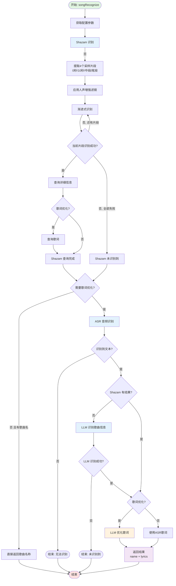
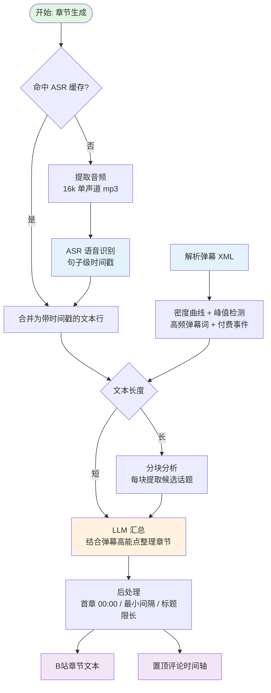

# 介绍

## 初始化

设置默认添加了千问的供应商，你仅需要配置key即可开始使用，首先查看[官方文档](https://help.aliyun.com/zh/model-studio/first-api-call-to-qwen)进行注册，拿到key后在“设置->AI配置->供应商”阿里云中并配置相关的key，由于我主要使用qwen进行开发，其他模型的兼容性未经过测试，如果有更多模型的支持，欢迎PR

软件还内置了 **Command Code** 供应商（OpenAI 兼容接口，Base URL 已预填），在 [commandcode.ai](https://commandcode.ai) 创建 API Key 后在“设置->AI配置->供应商->Command Code”中填上即可。默认已带一个模型 `deepseek/deepseek-v4.1-flash`（1M 上下文），章节生成默认使用它；需要其他模型时可以对照 [模型列表](https://api.commandcode.ai/provider/v1/models) 在“模型”页自己添加，模型名要填完整的 ID（如 `z-ai/glm-5.3-flash`）。GOAT 及以上计划才有 API 权限，Go 计划调用会返回 403。

接下来会介绍相关的一些功能。

## 歌切

位于切片右键选项中，为了此功能而引入的AI，目标是更快更好得识别音乐名称以及生成歌词

#### 流程图

## 字幕识别 && 歌词识别

位于切片右键选项中，目标就是为切片生成字幕了，逻辑也十分简单，将片段音频喂给asr引擎，拿到词级时间戳进行排版

### 字幕识别 && 歌词识别 有何区别

在某些接口中，字幕识别会主动过滤掉音乐片段，歌词识别则不会

### ffmpeg 的 Whisper 支持

由于 ffmpeg8.0 支持了[whispercpp](https://github.com/ggml-org/whisper.cpp)，但是本软件支持的只是7.1，由于8.0要求的cuda版本较高可能造成大量n卡硬件编码错误，所有软件本体的ffmpeg版本暂时不会更新。

但我仍然为想要使用的用户提供了渠道，只是需要一些额外的配置。

第一步的相关你也可以直接在[夸克网盘](https://pan.quark.cn/s/6da253a1ecb8)下载。

不推荐在歌词识别中使用~~当然你也识别不出什么~~，如果出现什么不能使用gpu加速也别来问我，我也不知道

#### 配置步骤

1. **下载 ffmpeg 8.0 和 Whisper 模型**
   - 下载 ffmpeg 8.0 版本（或从[夸克网盘](https://pan.quark.cn/s/6da253a1ecb8)获取）
   - 下载 Whisper 模型文件（[huggingface.co/ggerganov/whisper.cpp](https://huggingface.co/ggerganov/whisper.cpp)）
   - **推荐使用大参数模型**（如 `ggml-large-v3.bin`）以获得更好的识别效果
   - **后两步的路径中如包含空格或一些奇怪字符，可能会导致无法使用**

2. **配置供应商**
   - 打开：设置 -> AI配置 -> 供应商
   - 点击"添加供应商"
   - **供应商类型**：选择 `ffmpeg`
   - **配置名称**：自定义名称（如 "FFmpeg Whisper"）
   - **API Key**：随意填写（不会被使用）
   - **Base URL**：填写 ffmpeg 可执行文件的**完整路径**（如 `C:\ffmpeg\ffmpeg.exe`）

3. **添加模型配置**
   - 切换到"模型"选项卡
   - 点击"添加模型"
   - **供应商**：选择刚才创建的 ffmpeg 供应商
   - **模型名称**：填写 Whisper 模型文件的**完整路径**（如 `C:\models\ggml-large-v3.bin`）
   - **标签**：勾选 `ASR`
   - **备注**：可选，填写说明（如 "本地 Whisper 大模型"）

## 章节生成

位置：工具 - 章节生成。

输入一段**完整的录像文件**和对应的**弹幕 XML 文件**，自动分析并生成：

- **B站章节目录**：投稿页「分段章节」直接使用的时间 + 标题列表
- **置顶评论时间轴**：发布后置顶评论即可，时间戳可直接跳转

生成结果只作为文本输出，不会自动写入 B 站，需要你手动粘贴。

#### 流程图

#### 弹幕的用处

弹幕不仅是“参考”，还会参与分段决策：

- 弹幕密度峰值会作为章节分界的候选时间点
- 峰值附近的高频弹幕词会作为标题素材
- SC / 上舰 / 大额礼物等付费互动会加权为“高能时刻”

没有弹幕文件时，仍可仅根据语音内容生成，但标题质量会下降。

#### 配置

设置 - AI配置 - 功能 - 章节生成：

- **ASR模型**：为空时使用「字幕识别」中的模型
- **LLM模型**：用于整理章节的大模型，为空时使用模型列表中的第一个 LLM 模型
- **提示词**：最终汇总章节时使用的系统提示词
- **章节数量上限 / 章节最小间隔 / 标题字数上限**：默认 20 / 60秒 / 16字
- **单次文本上限**：默认 6000 字，超过就分块分析；模型上下文大的可以调大，避免分块后再汇总丢失细节
- **时间轴含高能点**：置顶评论时间轴中是否额外列出弹幕高能时刻

#### 注意事项

- 分析长视频时语音识别耗时较长，任务会进入任务队列，可在任务队列中查看进度
- 同一文件、同一 ASR 模型会复用缓存（与字幕识别共用），重复生成不会重复识别
- 当前不支持中断语音识别，中断只会阻止后续步骤

## 常见问题

### 是否支持小米 MiMO ASR 2.5

该模型不支持时间戳，因此不会被支持
